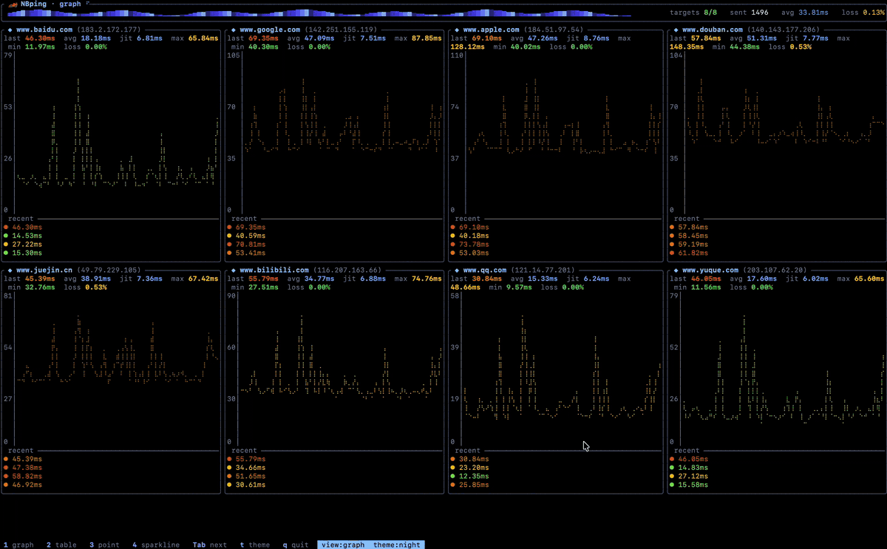
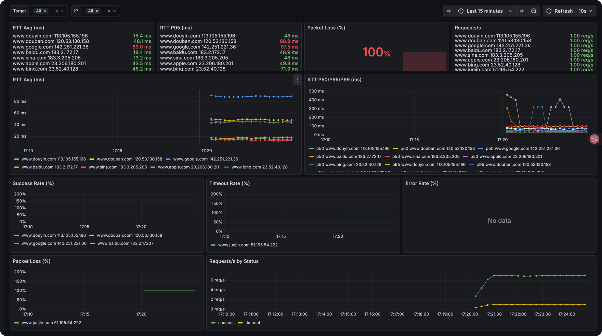

<h1 align="center"> 🏎 NBping </h1>
<p align="center">
    <em>NBping is a Ping tool developed in Rust. It supports concurrent Ping for multiple addresses, visual chart display, real-time data updates, and other features.</em>
</p>

<p align="center">
    
</p>

<p align="center">
    <a href="https://hellogithub.com/repository/21f5600774554866a3d686308df2dbf0" target="_blank">
        
    </a>
<a href="https://trendshift.io/repositories/13472" target="_blank"></a>
</p>


<p align="center">
    
</p>

[中文文档](./README_ZH.md)

📢 **NBPing (formerly Nping)**

> [!IMPORTANT]
> **Renaming Notice**
>
> This project has been officially renamed from **Nping** to **NBPing**.
>
> Please update your bookmarks, dependencies, and installation scripts accordingly. The old name is now deprecated and will no longer be maintained.
> ```bash
> nbping --help
> ```


**Exporter Mode**

Now NBping supports exporting ping metrics to Prometheus format, so you can visualize them with tools like Grafana.

```bash
nbping exporter www.baidu.com www.google.com -i 1 -p 9100
```
Then, you can scrape the metrics from `http://localhost:9100/metrics`

You can use Grafana to visualize the data:
<p align="center">
     
</p>


## Installation

#### MacOS Homebrew
```bash
brew install nbping

nbping --help
```

## Features:
- ICMP Ping and TCP Ping
- Concurrent probes for multiple targets
- Real-time TUI charts and Prometheus exporter
- Local SQLite history with time-range queries

## Roadmap:
- IP range Ping support
- Optimize UI interface, add more dynamic effects.

## Usage

```bash
nbping www.baidu.com www.google.com www.apple.com www.sina.com -c 20 -i 2

# TCP Ping measures the TCP handshake latency to port 443
nbping www.baidu.com --tcp --tcp-port 443

# Providing --tcp-port also enables TCP Ping
nbping www.baidu.com --tcp-port 443

nbping --help

🏎  NBping mean NB Ping, A Ping Tool in Rust with Real-Time Data and Visualizations

Usage: nbping [OPTIONS] [TARGET]... [COMMAND]

Commands:
  exporter  Exporter mode for monitoring
  history   Query probe history stored in a local SQLite database
  help      Print this message or the help of the given subcommand(s)

Arguments:
  [TARGET]...  target IP address or hostname to ping

Options:
      --config <CONFIG>        Path to a YAML config file (CLI flags override its values)
  -c, --count <COUNT>          Number of pings to send [default: 0 = unlimited]
  -i, --interval <INTERVAL>    Interval in seconds between pings [default: 0]
  -6, --force_ipv6             Force using IPv6 (config-only field can also enable this)
      --tcp                    Use TCP connect probes instead of ICMP ping
      --tcp-port <PORT>        TCP destination port [default: 80]
  -m, --multiple <MULTIPLE>    Specify the maximum number of target addresses, Only works on one target address [default: 0]
  -v, --view-type <VIEW_TYPE>  Initial view mode: graph/table/point/sparkline (switch at runtime with 1-4 / Tab) [default: graph]
  -o, --output <OUTPUT>        Output file to save ping results
      --history-db <PATH>      SQLite database to append queryable probe history
  -h, --help                   Print help
  -V, --version                Print version

```

### Local History

Store ICMP or TCP probe samples in a local SQLite database without running
Prometheus:

```bash
nbping ws.example.com --tcp-port 443 -i 1 --history-db nbping.db
```

Query an inclusive time range, optionally filtering by target:

```bash
nbping history --db nbping.db \
  --from "2026-09-15T14:00:00+08:00" \
  --to "2026-09-15T15:00:00+08:00" \
  --target ws.example.com
```

RFC3339 timestamps are recommended. Local `YYYY-MM-DD HH:MM[:SS]` values are
also accepted. Results are ordered by sample time and include availability,
success/timeout counts, RTT statistics, and individual samples. The database is
appended across runs. These records describe ICMP or TCP connectivity, not the
WebSocket protocol, authentication, or application messages.

### Exporter Usage

```bash
nbping exporter www.baidu.com www.google.com -i 1 -p 9100

# TCP Ping: -p is the Prometheus HTTP port; --tcp-port is the target service port
nbping exporter www.baidu.com --tcp-port 443 -i 1 -p 9100

./nbping exporter --help
Exporter mode for monitoring

Usage: nbping exporter [OPTIONS] [TARGET]...

Arguments:
  [TARGET]...  target IP addresses or hostnames to ping

Options:
      --config <CONFIG>      Path to a YAML config file (CLI flags override its values)
  -i, --interval <INTERVAL>  Interval in seconds between pings [default: 1]
  -p, --port <PORT>          Prometheus metrics HTTP port [default: 9090]
  -6, --force_ipv6           Force using IPv6 (config-only field can also enable this)
      --tcp                  Use TCP connect probes instead of ICMP ping
      --tcp-port <PORT>      TCP destination port [default: 80]
  -h, --help                 Print help
```

### Configuration file

Instead of passing everything on the command line, you can start NBping from a
YAML file with `--config`:

```bash
nbping --config nbping.yaml
```

The file mirrors the command-line flags. See [`nbping.example.yaml`](nbping.example.yaml):

```yaml
mode: tui              # tui | exporter (default: tui)
targets:
  - google.com
  - github.com
  - apple.com
  - baidu.com
  - 1.1.1.1
count: 0               # 0 = unlimited
interval: 1            # seconds
force_ipv6: false
tcp: true              # use TCP Ping; false keeps the default ICMP mode
tcp_port: 443          # target port; enables TCP unless tcp is explicitly false
multiple: 0            # tui mode only
view_type: graph       # graph | table | point | sparkline (tui mode only)
# output: results.log  # tui mode only
# history_db: nbping.db # tui mode only; appends queryable SQLite history
port: 9090             # exporter mode only
```

Notes:

- **Precedence:** command-line flags override the config file, which overrides
  built-in defaults (`CLI flag > YAML config > default`). For example,
  `nbping --config nbping.yaml -i 1` forces a 1-second interval regardless of the
  file.
- **Mode:** the `mode` field selects TUI or exporter mode when no subcommand is
  given. Running the explicit `nbping exporter ...` subcommand always uses
  exporter mode.
- **`force_ipv6`:** the `-6` flag can only turn IPv6 *on*; to disable IPv6 while a
  config enables it, set `force_ipv6: false` in the file.
- **TCP Ping:** TCP mode measures connection establishment latency. Timeouts,
  connection refusals, and other connection failures count as timeouts.
  `--tcp-port` selects the target service port, while exporter `-p/--port`
  selects the Prometheus HTTP listening port.
  In YAML, an explicit `tcp: false` keeps ICMP enabled while retaining `tcp_port`.
- **History:** `--history-db` or `history_db` appends samples to SQLite. The
  existing `--output` option remains a new-file-only plain text export.
- Unknown keys are rejected, so typos surface as errors at startup.


## Acknowledgements
Thanks to these people for their feedback and suggestions for 🏎NBping!

| [ThatFlower](https://github.com/ThatFlower) | [zx4i](https://github.com/zx4i) | [snail2sky](https://github.com/snail2sky) | [shenshouer](https://github.com/shenshouer) | [vnt-dev](https://github.com/vnt-dev) | [qingyuan0o0](https://github.com/qingyuan0o0) 
| [Onlywzr](https://github.com/Onlywzr)

Thanks to these self-media for reposting and paying attention to 🏎NBping!

| [阮一峰的网络日志](https://www.ruanyifeng.com/blog/weekly/) |[Rust 中文社区](https://rustcc.cn/) | [公众号:奇妙的linux世界](https://mp.weixin.qq.com/s/lK_OqKp2yY8lDBoyLxtdGA) | [公众号:IT运维技术圈](https://mp.weixin.qq.com/s/bDJZ-H02dIKG3R7LQCeyaQ)
| [X:@geekbb](https://x.com/geekbb/status/1875754541905539510) | [公众号:一飞开源](https://mp.weixin.qq.com/s/BZjr54h8dIQgzr8UW3fwOQ) | [公众号: 开源日记](https://mp.weixin.qq.com/s/uGtkD4x_XOFyKNbIy5pHYA)

## Star History
[](https://star-history.com/#hanshuaikang/Nping&Date)
